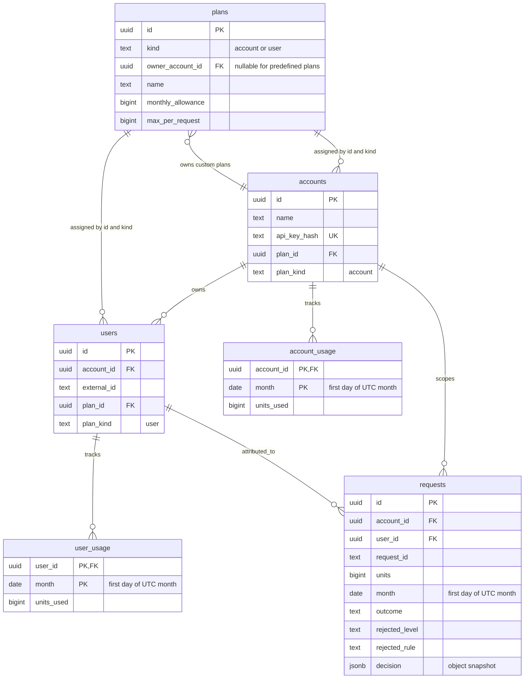
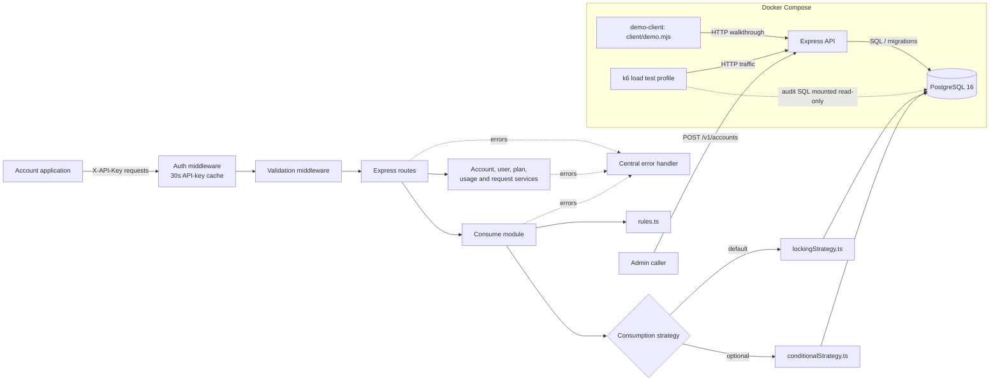
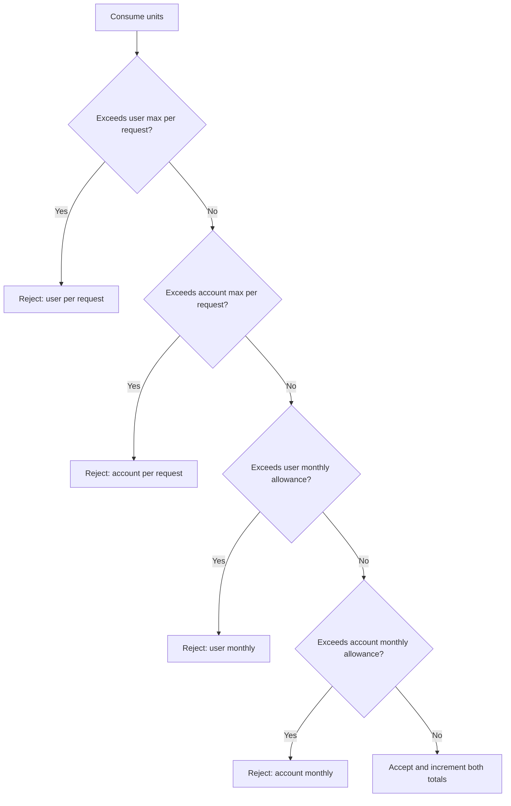
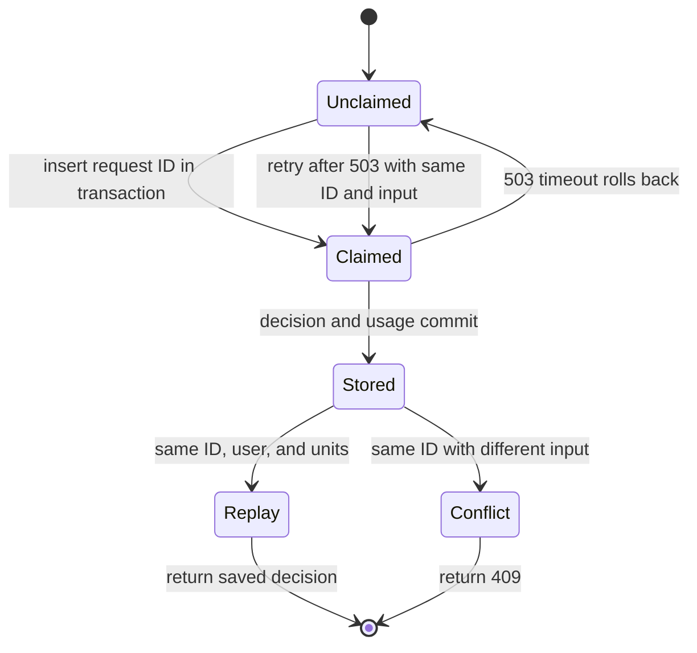

# Usage Metering and Quota Service diagrams

These diagrams describe the migrations and runtime flow in this checkout. The
database enforces the relationships, types of limits, and idempotency key
shape; custom-plan ownership is additionally checked by service code.

## Data model



Usage primary keys are `(account_id, month)` and `(user_id, month)`; unique
constraints cover `(id, kind)`, plan names within their owner scope,
`(account_id, external_id)`, and `(account_id, request_id)`, while a composite
`(user_id, account_id)` foreign key guarantees request ownership. Database
checks enforce plan kind, numeric bounds, first-of-month dates, valid decision
state, and `RESTRICT` deletion of referenced plans and users. `owner_account_id`
is nullable for predefined plans, while same-account custom-plan ownership is
checked in service code.

## Architecture and runtime boundaries



The client and k6 runner are separate Compose services; k6 is enabled through
the `loadtest` profile, while the API and PostgreSQL form the persistent
service stack. API requests pass through authentication, validation, and
routes; consume applies the shared rules through either the default row-locking
strategy or the opt-in conditional strategy.

## Accepted consume request, replay, rejection, and timeout

```mermaid
sequenceDiagram
    autonumber
    actor Caller
    participant Auth as Auth middleware
    participant API as Express consume route/service
    participant DB as PostgreSQL
    Caller->>Auth: POST /v1/consume with API key
    alt API-key cache hit
        Auth-->>API: Account ID
    else Cache miss
        Auth->>DB: Look up API-key hash
        DB-->>Auth: Account ID; cache for 30 seconds
        Auth-->>API: Account ID
    end
    API->>API: Validate body
    API->>DB: pool.connect(); BEGIN
    API->>DB: Set transaction-local lock_timeout and statement_timeout
    API->>DB: Read UTC month, account/user and plans; FOR SHARE OF account
    API->>DB: Claim (account_id, request_id)
    alt ID already claimed
        API->>DB: Read stored row and compare user and units
        alt Same input
            DB-->>API: Stored decision JSONB
            API->>DB: COMMIT
            API-->>Caller: Original decision; replayed=true
        else Different input
            API->>DB: ROLLBACK
            API-->>Caller: 409 request_id_conflict
        end
    else New claim
        API->>DB: Lock user_usage row
        opt User usage row missing
            API->>DB: Create row with ON CONFLICT DO NOTHING; lock again
        end
        API->>DB: Lock account_usage row
        opt Account usage row missing
            API->>DB: Create row with ON CONFLICT DO NOTHING; lock again
        end
        API->>API: Evaluate rules.ts in fixed order
        alt Rejected
            API->>DB: Store rejected outcome and decision; no usage change
            API->>DB: COMMIT
            API-->>Caller: accepted=false; replayed=false
        else Accepted
            API->>DB: Combined CTE updates both totals and request outcome/decision
            API->>DB: COMMIT
            API-->>Caller: accepted=true; replayed=false
        end
    end
    opt PostgreSQL error 55P03 or 57014
        API->>DB: ROLLBACK (also removes the uncommitted claim)
        API-->>Caller: 503 busy with Retry-After
        Note over Caller: Retry same request_id, user, and units
    end
```

Authentication and body validation happen before the consume transaction.
Pool acquisition also precedes `BEGIN`; the transaction then reads current
plans, claims the ID, and serializes usage access in user-then-account order.
Accepted requests update both usage totals and the stored decision in one
statement; rejections store a decision without changing usage. A timeout rolls
back the claim, so the caller can retry with the same inputs and ID.

## Rule evaluation order



`rules.ts` stops at the first failing rule, in this order: user per-request,
account per-request, user monthly, account monthly. Remaining units at each
level are `max(0, limit - used)`; an accepted request increments both levels.

## Idempotency states



The claim and decision live in the same PostgreSQL transaction, which means a
timeout leaves the ID available for a safe retry. Once committed, identical
input replays the saved JSON decision and changed input receives HTTP 409.
